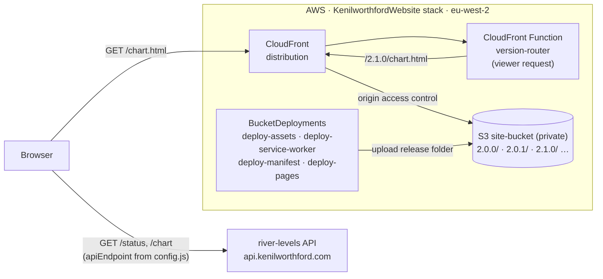
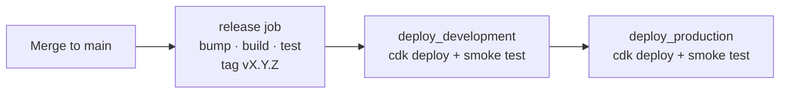

# Infrastructure

This page describes what the CDK app deploys, how a release reaches the site, how it's tested and how to roll back. The source of truth is the code in [`src/`](../src). If you change the infrastructure, update this page in the same PR.

- **App entry point:** [`src/main.ts`](../src/main.ts)
- **Stacks:** `KenilworthfordWebsite` ([`WebsiteStack`](../src/website-stack/index.ts)), in `eu-west-2`, and, for a stage with a domain, `KenilworthfordWebsiteCertificate` ([`CertificateStack`](../src/website-stack/certificate-stack.ts)), in `us-east-1`
- **Environments:** `development` and `production`, deployed by GitHub Actions to the River Levels Dev (397002077817) and River Levels Prod (851725533908) accounts, alongside the river-levels API

## Architecture



| Resource | Construct ID | Notes |
| --- | --- | --- |
| S3 bucket | `site-bucket` | Private, S3-managed encryption, SSL only. Retained if the stack is deleted, as it holds every release. |
| Bucket deployments | `deploy-assets`, `deploy-service-worker`, `deploy-manifest`, `deploy-pages` | Upload the release to `<version>/`, one per Cache-Control setting (below). They never prune and keep their files when replaced, so earlier releases stay. |
| CloudFront Function | `version-router` | Rewrites each request to the active release's folder ([`version-router.ts`](../src/website-stack/version-router.ts)). Depends on every deployment, so it only switches once the release is uploaded. |
| CloudFront distribution | `distribution` | Origin access control to the bucket, `CachingOptimized`, managed security headers, HTTP/2 and 3, `PriceClass_100`, HTTPS redirect. Serves the stage's domain, if it has one. |
| ACM certificate | `certificate` (certificate stack) | The stage's domain, validated by DNS. In us-east-1, as CloudFront requires. |

Outputs: `DistributionDomainName`, `DistributionId`, `BucketName`, `Version`, and `SiteDomain` for a stage with a domain.

### Domains

| Stage | Domain |
| --- | --- |
| `development` | `dev.kenilworthford.com` |
| `production` | `kenilworthford.com`, still on the old distribution in the management account. The distribution has its certificate, ready for the domain to move (below). |

The domains come from `siteDomain()` in [`src/stage.ts`](../src/stage.ts). Their hosted zones are in the management account, managed by endor-infrastructure, so DNS is split:

- **This app** requests the certificate and adds the domain to the distribution. The website stack reads the certificate's ARN from the certificate stack's output (a weak cross-region reference, `Fn::GetStackOutput`).
- **endor-infrastructure** holds the certificate's validation CNAME and the A/AAAA alias records that point the domain at the distribution.

ACM gives the same validation record each time for a domain in an account, so add it to endor-infrastructure before the first deploy, and the certificate is issued straight away. Until the record exists, the certificate stack's deploy waits for validation. To find the record for a new domain, request a certificate for it in the account's us-east-1 with `aws acm request-certificate --validation-method DNS`, read its `DomainValidationOptions`, then delete it.

A domain can only be on one CloudFront distribution at a time. To move one here from another distribution:

- **With a gap** (as for development): remove it from the other distribution, wait until that distribution is deleted, then deploy.
- **Without a gap** (for production):
  1. Set `pendingMove` on the stage's domain and deploy. The distribution gets the certificate but not the domain.
  2. In endor-infrastructure, add a TXT record, `_<domain>`, with the distribution's domain name as its value. It authorizes the move.
  3. In the stage's account, run `aws cloudfront associate-alias --target-distribution-id <id> --alias <domain>`. CloudFront moves the domain and serves it from this distribution straight away, even before DNS changes, because it routes by host name.
  4. Remove `pendingMove` and deploy. Point the A/AAAA records at the distribution, and remove the TXT record.

### Bucket layout and caching

The site is built into `dist/site/<version>/` ([`site/webpack.prod.js`](../site/webpack.prod.js)), and every URL in it is absolute under `/<version>/`, so a release is a self-contained folder:

| Files | Cache-Control | Why |
| --- | --- | --- |
| `<version>/assets/*` | `public, max-age=31536000, immutable` | Hashed file names |
| `<version>/sw.js`, `<version>/manifest.webmanifest` | `no-cache` | A new release's service worker and manifest are picked up straight away |
| Everything else, including `<version>/config.js` | `public, max-age=300` | Pages |

`config.js` isn't built. The deploy writes it from [`src/stage.ts`](../src/stage.ts) (`apiEndpoint`), so the same build deploys to every stage, and a rollback rolls it back too.

### Version router

| Request | Served from |
| --- | --- |
| `/`, `/chart.html`, `/sw.js`, `/config.js` | `/<active>/index.html`, `/<active>/chart.html`, … |
| `/2.1.0/assets/app.1a2b.js` (already versioned) | Unchanged, so a page loaded before a switch keeps loading its own assets |
| `/?version=2.0.9` | `/2.0.9/index.html`, to preview any release in the bucket |

CloudFront caches by the rewritten path, so switching release needs no invalidation.

## Releases



1. Each merge to `main` runs the `release` workflow. Its version comes from the conventional commit types since the last tag (`fix` patch, `feat` minor), starting at 2.0.0.
2. The release job bumps `package.json`, runs `npx projen build`, which builds the site as that version before synthesizing and testing, and uploads `dist/` (with `releasetag.txt` and `site/<version>/`) as the build artifact.
3. Each deploy job downloads that artifact, so it deploys exactly what was tested, assumes the environment's `AWS_DEPLOYMENT_ROLE_ARN` role, and runs `yarn deploy` with `STAGE` set. That runs `cdk deploy --all`, then the smoke test. Production only runs once development passes.

The deploy roles, `github/kenilworthford-website-provisioning`, are in endor-infrastructure (`accounts/river-levels-{dev,prod}/iam_github_kenilworthford_website.tf`). They trust this repo's `development` and `production` GitHub environments, and can only assume the accounts' CDK bootstrap roles.

## Testing

| Test | Where | Catches |
| --- | --- | --- |
| Version router | [`test/website-stack/version-router.spec.ts`](../test/website-stack/version-router.spec.ts) | Runs the generated function code: routing, passthrough of versioned paths, preview validation |
| Stack | [`test/website-stack/index.spec.ts`](../test/website-stack/index.spec.ts) | Private bucket, OAC, version folder, no pruning, Cache-Control per file type, router depends on every deployment |
| Site build | [`test/site/build-output.spec.ts`](../test/site/build-output.spec.ts) | Every file the pages, manifest and service worker refer to is in the release, nothing refers to another release, the offline page is precached and only shown when the network fails |
| Browser | [`test/browser/`](../test/browser) | Runs the site build in Chromium (Playwright), served by a local server that runs the real version router and serves canned API responses: the home page shows the API's status, every page loads once the service worker controls it, and offline it serves visited pages from the cache and the offline page for the rest |
| Smoke test checks | [`test/smoke-test/checks.spec.ts`](../test/smoke-test/checks.spec.ts) | The post-deploy checks themselves, against a fake site |
| Version and stage | [`test/version.spec.ts`](../test/version.spec.ts), [`test/stage.spec.ts`](../test/stage.spec.ts) | Version resolution and validation, API endpoint per stage |
| **Post-deploy smoke test** | [`src/smoke-test/`](../src/smoke-test) | Run by `yarn deploy` against the live distribution. Waits up to 5 minutes for `/` to serve the release, then checks every asset it references, every page, `?version=` previews, `config.js`'s endpoint, and the service worker's and manifest's headers |

`npx projen build` runs everything except the smoke test, which needs a deployment. Run it on its own after a deploy with `npx projen smoke-test`. Run the browser tests on their own with `npx projen test:browser`, after `npx projen site:build`. A failure leaves a Playwright trace in `test-reports/browser/`.

## Rollback

Every release stays in the bucket.

- **Preview** any release without changing the site: `https://<site>/?version=2.0.9`.
- **Roll back** by opening the earlier release's workflow run and re-running only its deploy job (**Re-run this job** on `Deploy to Production`). That redeploys the release's own artifact, while its artifact is still retained. Don't use **Re-run all jobs**: the release job finds the tag already exists, and skips the deploys.
- Otherwise, revert the change and let the next release deploy it.

Either way, a deploy only uploads files the bucket may already have, and changes which folder the router serves.

## Local development

```sh
npx projen site:serve    # webpack dev server with canned API responses, http://localhost:8080
npx projen build         # site build, synth, tests, lint
```

Deploying from a laptop (`npx projen deploy`) needs credentials for a river-levels account, and deploys `0.0.0` unless `VERSION` is set and built.

## Still to do

1. **Production domain cutover.** `kenilworthford.com` is still served by the old distribution in the management account (endor-infrastructure `applications/prod-kenilworthford`). Move it without a gap (see [Domains](#domains)).
2. **Regional redundancy**, like the API: a second bucket in another region, with an origin group.
3. **Retire the old setup** after cutover: the `prod-kenilworthford` and `dev-kenilworthford` roots, the `application_config` module, and the static-website-versioning repo.
